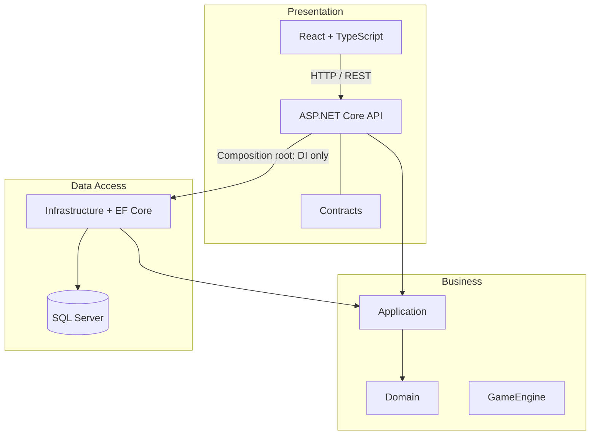

# Kiến trúc Xiangqi Online

## Mô hình 3 tầng

### Presentation

- `XiangqiOnline.API`: HTTP controllers, CORS, middleware, health checks, Swagger và điểm ghép dependency injection.
- `XiangqiOnline.Contracts`: DTO và payload công khai cho REST/SignalR.
- `frontend/xiangqi-web`: React, TypeScript strict mode, trang và component bàn cờ.

### Business

- `XiangqiOnline.Application`: use cases, interface dịch vụ, validation và mapping.
- `XiangqiOnline.Domain`: entity nghiệp vụ, enum và quy tắc độc lập framework.
- `XiangqiOnline.GameEngine`: mô hình bàn, quân, FEN và interface luật cờ. Không tham chiếu EF Core, API hoặc UI.

### Data Access

- `XiangqiOnline.Infrastructure`: `AppDbContext`, Fluent API, migration và triển khai lưu trữ.
- SQL Server là nguồn dữ liệu duy nhất; không dùng SQLite.

API tham chiếu Business để gọi nghiệp vụ. Tại điểm khởi động, API biết Infrastructure để đăng ký triển khai. Infrastructure tham chiếu abstraction Business. Domain không tham chiếu tầng nào khác; không có project dependency vòng tròn.

## Xác thực Phase 2

- Controller thuộc Presentation chỉ chuyển DTO/HTTP; `AuthenticationService` trong Application điều phối use case và repository; Infrastructure triển khai EF Core, `PasswordHasher<User>` và phát JWT.
- Access token JWT sống 15 phút. Refresh token ngẫu nhiên chỉ lưu SHA-256 hash trong SQL và được xoay vòng khi refresh; cookie `HttpOnly`, `SameSite=Strict`, `Secure` ngoài Development.
- Frontend giữ access token trong bộ nhớ, refresh cookie do trình duyệt quản lý; không ghi token vào localStorage.

## Ranh giới phase

Phase 1 hiện thực model, migration, API foundation và kiểm tra health, game-engine foundation, giao diện và tài liệu hợp đồng. Phase 2 hiện thực authentication và hồ sơ. Tạo/join phòng, luật nước đi, multiplayer, chat và video chưa có endpoint xử lý. Frontend không phát sinh request giả và không xác nhận nước đi.

## Quyết định vận hành

- Dùng UTC cho timestamps. Xử lý nước đi sau này phải ghi move/event và tăng `Game.Version` trong một transaction, đồng thời kiểm tra version mong đợi.
- API tạo `X-Request-Id`, log JSON có cấu trúc và trả `ProblemDetails` an toàn.
- CORS đọc allowlist từ cấu hình. Môi trường production phải đặt allowlist riêng.
- Connection string lấy từ User Secrets hoặc environment; mẫu local dùng Windows Authentication.
- .NET target theo yêu cầu `net8.0`. Tại ngày 31-10-2026, hỗ trợ .NET 8 kết thúc ngày 10-11-2026; kế hoạch nâng target cần được thực hiện trước mốc này.
